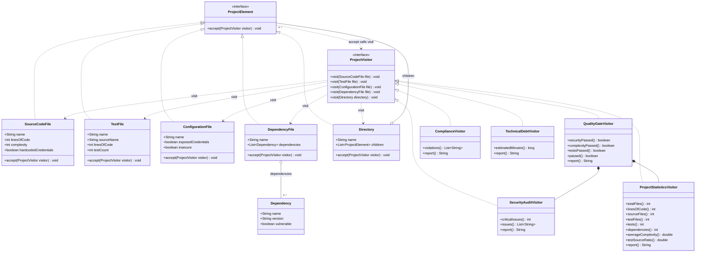
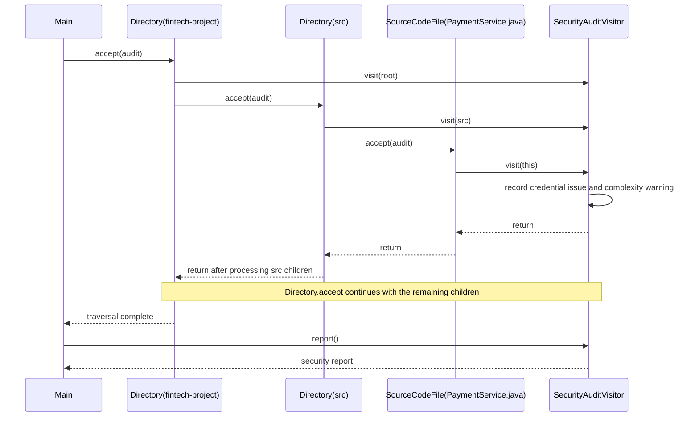

# UML diagrams

## Class diagram

Each concrete visitor implements all five `visit` overloads. Java records expose the listed data through accessor methods. `Main` creates the `DemoProject` and runs all five visitors on the same root.

## Sequence diagram

